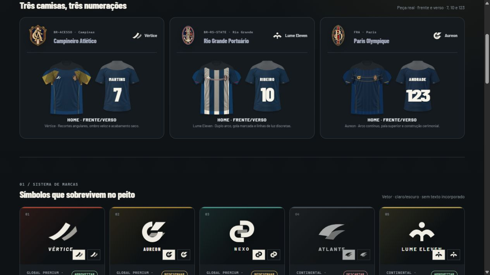
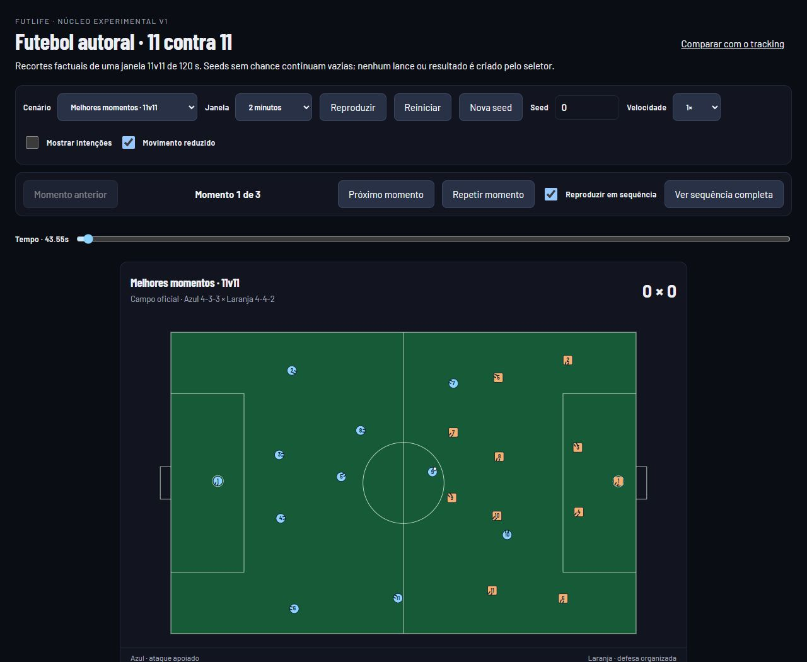

# Futlife — simulador de vida e carreira no futebol

**Uma vida inteira no futebol, da infância ao epílogo.** RPG narrativo de futebol em desenvolvimento.

🔗 **Página do projeto:** <https://cingez.github.io/futlife-showcase/> · [English version](https://cingez.github.io/futlife-showcase/en/)

Futlife é um jogo de futebol narrativo: um simulador de vida e carreira esportiva em que você acompanha uma pessoa, e não um clube. A trajetória começa aos 6 anos e pode passar pela escolinha, pelas categorias de base, pela carreira profissional e por outros papéis no futebol. O jogador escolhe como se preparar, se relacionar e responder aos acontecimentos. Resultados esportivos são resolvidos pela simulação, não por um botão de vitória.

> **Estado:** alpha fechada para testes. Futlife ainda é um nome de trabalho.

## Imagens do projeto

### A vida no painel inicial

*Home mobile capturada em setembro de 2026: continuidade da vida e próximos acontecimentos.*

### Identidade dos clubes e camisa vista por trás

*Estudo de três uniformes autorais capturado em agosto de 2026. As camisas mostram nome e número no verso.*

### Futebol em campo

*Laboratório isolado de movimento 11 contra 11, capturado em setembro de 2026. A cena é experimental e não representa uma partida completa da carreira.*

## O que já existe

- Criação de personagem, infância, escola, escolinha e categorias de base.
- Carreira de atleta com temporadas, contratos, relações e consequências persistidas.
- Partidas com Match Day 2D e leitura das causas no pós-jogo.
- Continuidade da mesma biografia em capítulos de técnico e dono, conforme a trajetória.
- Mundo com clubes, competições, pessoas, imprensa e memória da carreira.
- Saves versionados para interromper e retomar a vida.

O projeto ainda passa por calibração e testes de trajetórias longas. Esta página mostra a direção e o estado da alpha; não anuncia uma versão final.

## Experimentar a alpha

A [alpha online](https://futlife-alpha.onrender.com/) exige convite e senha de acesso. Para manifestar interesse em testar, [abra uma issue](https://github.com/cingez/futlife-showcase/issues/new/choose) contando brevemente que tipo de experiência você gostaria de avaliar. Não publique dados pessoais ou senhas na issue.

## Perguntas frequentes

**É um jogo de gerenciamento como o Football Manager?** Não. Você vive uma trajetória pessoal: escolhe preparo, relações e respostas aos acontecimentos, e a simulação resolve o que acontece em campo.

**Dá para jogar agora?** Só na alpha fechada, por convite e senha.

**O código é aberto?** Não. Este repositório é a apresentação pública; o motor, a API e a interface ficam em repositório privado.

## Como foi construído

O núcleo é um motor determinístico em TypeScript: decisões produzem fatos e histórico causal persistidos; saves são versionados. Uma API com SQLite serve a interface web responsiva em React e Vite. O projeto separa contratos, regras de domínio, serviço e interface para que a simulação continue independente das telas.

Este repositório é uma **apresentação pública** do projeto. O código completo, a documentação interna e o histórico de desenvolvimento permanecem no repositório privado. As imagens desta vitrine não recebem licença de reutilização.

---

## English

**Futlife — a football life and career simulator.**

Futlife is a work-in-progress narrative soccer RPG: a football life sim where you follow one person instead of a club. Life starts at age six and can run through a local academy, youth football, a professional career and other roles in the game. You choose how to prepare, who to build relationships with and how to respond to events; match results are resolved by the simulation, never picked directly.

- **Project page:** <https://cingez.github.io/futlife-showcase/en/>
- **Status:** closed alpha, invite-only and password protected.
- **Ask for access:** [open an issue](https://github.com/cingez/futlife-showcase/issues/new/choose) describing what you would like to evaluate.

Built on a deterministic TypeScript engine with persisted causal history and versioned saves, an SQLite-backed API and a responsive React + Vite interface. This repository is a public showcase; the full source code is private, and the images are not licensed for reuse.

<!--
Palavras-chave / keywords: simulador de vida no futebol, simulador de carreira no futebol,
jogo de futebol narrativo, RPG de futebol, jogo de carreira de jogador de futebol,
football life simulator, soccer career simulator, narrative football game, football career RPG,
life sim, indie football game, TypeScript game engine.
-->
