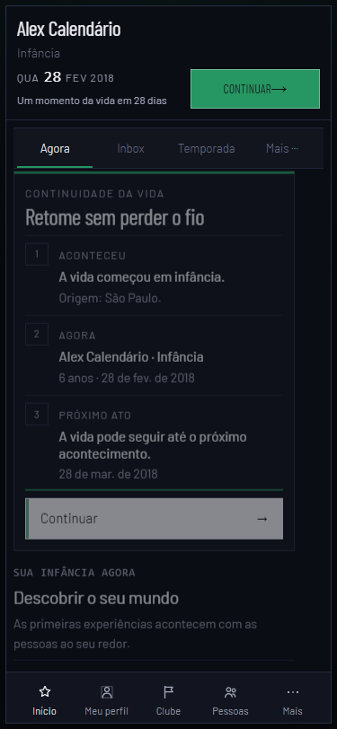

# Futlife — simulador de vida e carreira no futebol

**Uma vida inteira no futebol, da infância ao epílogo.**

Futlife é um jogo de futebol narrativo em desenvolvimento: um simulador de vida e carreira no futebol. A trajetória começa aos 6 anos e pode passar pela escolinha, categorias de base, carreira profissional e outros papéis no futebol. O jogador escolhe como se preparar, se relacionar e responder aos acontecimentos. Resultados esportivos são resolvidos pela simulação, não por um botão de vitória.

> **Estado:** alpha fechada para testes. Futlife ainda é um nome de trabalho.

## Imagens do projeto

### A vida no painel inicial

*Home mobile capturada em setembro de 2026: continuidade da vida e próximos acontecimentos.*

### Identidade dos clubes e camisa vista por trás

*Estudo de três uniformes autorais capturado em agosto de 2026. As camisas mostram nome e número no verso.*

### Futebol em campo

*Laboratório isolado de movimento 11 contra 11, capturado em setembro de 2026. A cena é experimental e não representa uma partida completa da carreira.*

## O que já existe

- Criação de personagem, infância, escola, escolinha e categorias de base.
- Carreira de atleta com temporadas, contratos, relações e consequências persistidas.
- Partidas com Match Day 2D e leitura das causas no pós-jogo.
- Continuidade da mesma biografia em capítulos de técnico e dono, conforme a trajetória.
- Mundo com clubes, competições, pessoas, imprensa e memória da carreira.
- Saves versionados para interromper e retomar a vida.

O projeto ainda passa por calibração e testes de trajetórias longas. Esta página mostra a direção e o estado da alpha; não anuncia uma versão final.

## Experimentar a alpha

A [alpha online](https://futlife-alpha.onrender.com/) exige convite e senha de acesso. Para manifestar interesse em testar, [abra uma issue](https://github.com/cingez/futlife-showcase/issues) contando brevemente que tipo de experiência você gostaria de avaliar. Não publique dados pessoais ou senhas na issue.

## Como foi construído

O núcleo é um motor determinístico em TypeScript: decisões produzem fatos e histórico causal persistidos; saves são versionados. Uma API local com SQLite serve a interface web responsiva em React e Vite. O projeto separa contratos, regras de domínio, serviço e interface para que a simulação continue independente das telas.

Este repositório é uma **apresentação pública** do projeto. O código completo, a documentação interna e o histórico de desenvolvimento permanecem no repositório privado. As imagens desta vitrine não recebem licença de reutilização.

---

**English:** Futlife is a work-in-progress football career simulator and narrative soccer life sim. Start at age six, make decisions across childhood and a football career, and see how the world responds. The online alpha is invite-only. This repository is a public project showcase; the full source code is private.
